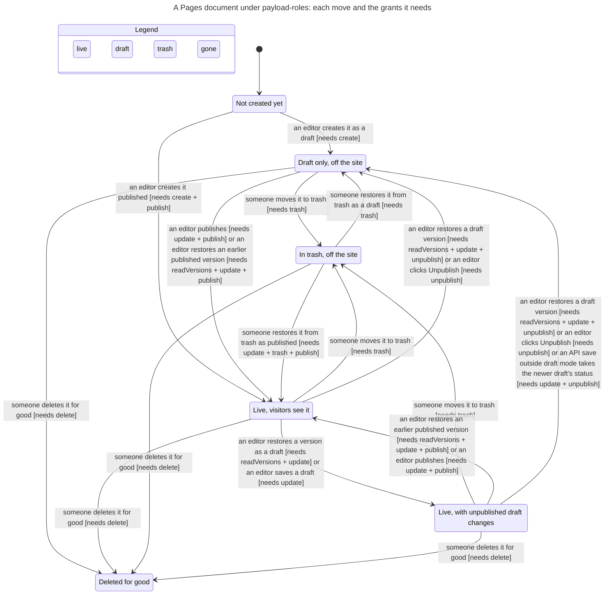

# Document lifecycle under payload-roles

A Pages document can be a draft that is off the site, live, live with a newer draft waiting, in the trash, or deleted for good. Each arrow is a move a member makes, with the grants that move needs. If the member lacks a grant, the move is refused with 403 and nothing stored changes. Only `publish` puts a page live, and it needs `update` too unless the move creates the page. A live page comes down through `unpublish`, `trash` (when it goes to the trash), or `delete` (when it is deleted for good). The README documents that a permanent delete needs only `delete`.

The model covers a resource with drafts and trash, such as the `pages` fixture in `packages/payload-roles/tests/helpers/payload.ts`. The demo app's Pages collection uses the same Payload draft states, but the demo app does not install payload-roles.



## Rules

All rules hold. TLC checked 452 states for the chart config, in which `update`, `publish`, `unpublish`, and `trash` vary. It checked 3,084 states with all seven grants varying (`DocumentLifecycleAllGrants.cfg`, check only).

| Rule                                    | In plain words                                                                                                         |
| --------------------------------------- | ---------------------------------------------------------------------------------------------------------------------- |
| `RefusedMoveChangesNothing`             | A refused move changes nothing stored.                                                                                 |
| `GoesLiveOnlyWithPublish`               | A document only becomes live through someone holding `publish`, and `update` unless the move creates it.               |
| `TakingDownNeedsUnpublishTrashOrDelete` | Taking a live document down needs `unpublish`, `trash` if it goes to the trash, or `delete` if it is deleted for good. |
| `PublishNeverWithoutUpdate`             | A role never grants `publish` without `update`.                                                                        |
| `PendingDraftOnlyOverLive`              | "Unpublished draft changes" exist only on a live document. Visitors never see the pending draft.                       |

`TakingDownNeedsUnpublishTrashOrDelete` first stated only unpublish and trash, and TLC broke it with "create published, then delete for good". A replay against the real code confirmed that a member holding `delete` but not `unpublish` or `trash` can delete a live page. That is the documented rule (`packages/payload-roles/README.md`, "Permanent delete" needs `delete`), so the rule now names delete. If a permanent delete of a live page should need more, that is a product decision.

`PublishNeverWithoutUpdate` holds because saving a role refuses `publish` without `update` (`checkPermissions` in `src/grants.ts`). Enforcement does not check it again when it loads roles.

## What the model leaves out

- Version history is reduced to "has a published version". Trashed snapshots are not modelled.
- Editing inside the trash, creating a trashed document, duplicates, bulk updates, and status-only saves on a draft are left out.
- Uploads, globals, resources without drafts, super admins, outsiders, trusted Local API writes, nested operations, and the two-phase plan-then-settle check are left out. Moves are judged on a known stored row.
- Edit locks and when the Unpublish button is shown are left out.
- The chart hides refused attempts and the end-state stutter, which stay in one state, and "an admin changes the editor's role", which changes nothing stored.

## Regenerate

From [`document-lifecycle/`](document-lifecycle/), with the `scripts/statechart` command of the pstack `statechart` skill:

```sh
statechart DocumentLifecycle.tla --config DocumentLifecycle.cfg --view view.mjs --out /tmp/lifecycle-chart
statechart DocumentLifecycle.tla --config DocumentLifecycleAllGrants.cfg --view view.mjs --out /tmp/lifecycle-all-grants
```
