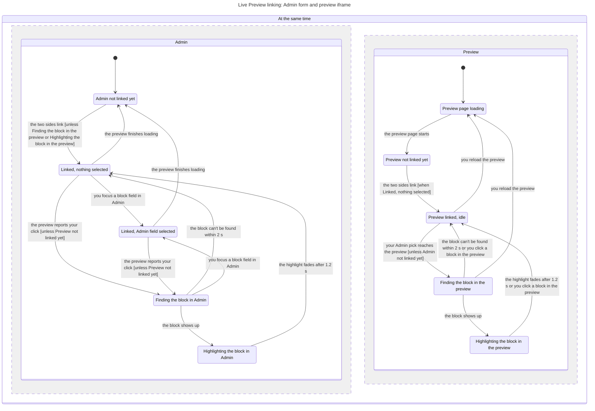

# Live preview linking

The Admin form and the Live Preview iframe each start unlinked, link after the ready and ack handshake, and then find and highlight blocks. Nothing happens on either side before both have linked. A reload sends both back to unlinked and clears the Admin selection and any pending find, so no stale timeout fires later. Focusing a field in Admin cancels Admin's own pending find, and a click reported from the preview makes Admin forget its selection. A click in the preview cancels the preview's own pending find and any highlight, so the preview never jumps to an older block than the one you clicked. All rules hold.



## Rules

| Rule                          | In plain words                                                                                                   | Result |
| ----------------------------- | ---------------------------------------------------------------------------------------------------------------- | ------ |
| `OneFindPerSide`              | Each side has at most one find pending.                                                                          | Holds  |
| `NothingBeforeLink`           | Neither side looks for or highlights a block, or keeps a selection, before it links.                             | Holds  |
| `AdminPickCancelsFind`        | Picking a field in Admin cancels any find still pending in Admin.                                                | Holds  |
| `PreviewClickCancelsFind`     | Clicking a block in the preview stops the preview looking for an earlier block.                                  | Holds  |
| `PreviewClickClearsSelection` | After the preview reports a click, Admin forgets its selection, so focusing that field again sends a new locate. | Holds  |
| `ReloadClearsSelection`       | After a reload, Admin drops the old selection before the new page links, and no stale find survives the reset.   | Holds  |

The chart config uses two blocks, at most one message in flight each way, and block symmetry (306 states). `PreviewLinkingDeep.cfg` allows three messages each way with no symmetry (64,893 states) and gives the same results. Breaking the model one guard at a time made each holding rule fail on its own change, so no rule holds vacuously.

The `click` handler in `packages/payload-live-preview/src/bridge.ts` calls `work.cancel()` and `visuals.cancelReveal()` before it sends `locate`, as the Admin `select` in `src/client.tsx` does. Before [#134](https://github.com/codlume/payload-toolkit/issues/134), it sent only `locate`, and for up to 2 seconds the preview could jump to an earlier Admin pick.

## What the model leaves out

- Within a find, the try, the watch, and the 300 ms collapsed-ancestor wait are one finding state.
- A reveal (scroll, the 700 ms `scrollend` fallback, then the flash) is one step. A preview click also cancels a preview scroll already in progress, which the model cannot show.
- The row-header click that always resends, ancestor fallback ids, hover, origin, source, and payload validation, and nested bridge registrations.
- Exit Live Preview and effect reruns on a locale or URL change. They use the same reset as a reload.
- Only two blocks exist, messages to the old page are lost on reload, and only one reload is pending at a time.
- The chart hides the relink resets from every linked state, "the preview finishes loading" from finding or highlighting in Admin, "you reload the preview" from the unlinked and highlighting preview states, an Admin pick or a reported click while the Admin highlight fades, and an Admin pick reaching a highlighting preview. It also does not draw the 190 steps that stay inside one chart state, such as dropped messages.

## Regenerate

From [`live-preview-linking/`](live-preview-linking/), with the `scripts/statechart` command of the pstack `statechart` skill:

```sh
statechart PreviewLinking.tla --config PreviewLinking.cfg --view view.mjs --out /tmp/linking-chart
statechart PreviewLinking.tla --config PreviewLinkingDeep.cfg --view view.mjs --out /tmp/linking-deep
```
