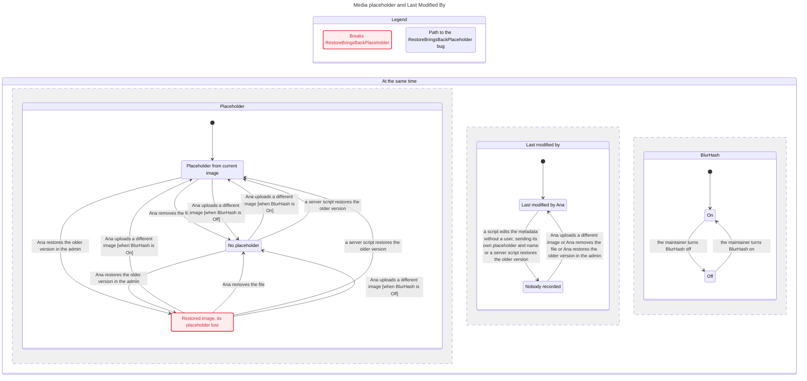

# Media placeholder and Last Modified By

A media document in the demo app has three independent parts: its BlurHash placeholder, its `Last Modified By` name, and whether BlurHash generation is on. The placeholder always matches the current image or is empty, and no caller can write the placeholder or the name directly. Every change Ana makes records Ana, and every change without a user clears the name. The red state is a real defect, [#133](https://github.com/codlume/payload-toolkit/issues/133). When an editor restores an older version through Admin or REST, the image comes back without its placeholder. A server-side restore brings it back.



## Rules

| Rule                           | In plain words                                                                        | Result                                     |
| ------------------------------ | ------------------------------------------------------------------------------------- | ------------------------------------------ |
| `PlaceholderMatchesImage`      | The placeholder always matches the current image or is empty, never an older image's. | Holds                                      |
| `CallerCannotWrite`            | A caller can never write the placeholder or the name directly.                        | Holds                                      |
| `RestoreBringsBackPlaceholder` | Restoring a version brings back that version's placeholder.                           | Breaks: path 0 to 1, Ana restores in Admin |
| `AdminEditRecordsUser`         | An edit by an admin user records that user.                                           | Holds                                      |
| `UserlessEditRecordsNobody`    | An edit with no user clears the name, so an earlier editor is not shown.              | Holds                                      |

The broken path was replayed against the real code with REST requests as a logged-in user. The upload stored `blurHash: "LJPH??]9fQ]9|co1fQo1fQfQfQfQ"`, and `POST /api/media/versions/:id` returned the restored file with `blurHash: null`.

## What the model leaves out

- Only one older version exists, the first upload. Versions saved without a placeholder are not modelled.
- Drafts, autosave, duplicates, and uploads that cannot be decoded are left out. Undecodable uploads store an empty placeholder.
- Activity is always on, as in `apps/payload-cms/src/app-config.ts`. Set `ActivityOn = FALSE` in the config to model the disabled plugin.
- The Site Settings global's restore hook, users from other auth collections, nested writes, S3 storage, and concurrent writes.
- The chart hides "Ana edits the metadata". Its only visible move, from `Nobody recorded` to `Last modified by Ana`, repeats Ana's other arrows.

## Regenerate

From [`media-placeholder/`](media-placeholder/), with the `scripts/statechart` command of the pstack `statechart` skill:

```sh
statechart MediaPlaceholder.tla --config MediaPlaceholder.cfg --view view.mjs --out /tmp/media-chart
```
