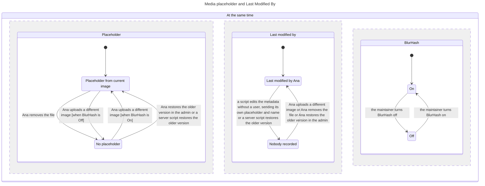

# Media placeholder and Last Modified By

A media document in the demo app has three independent parts: its BlurHash placeholder, its `Last Modified By` name, and whether BlurHash generation is on. The placeholder always matches the current image or is empty, and no caller can write the placeholder or the name directly. Every change Ana makes records Ana, and every change without a user clears the name. A restore brings back the older version's placeholder, whether an editor restores through Admin or REST or a server script restores. All rules hold.



## Rules

| Rule                           | In plain words                                                                        | Result |
| ------------------------------ | ------------------------------------------------------------------------------------- | ------ |
| `PlaceholderMatchesImage`      | The placeholder always matches the current image or is empty, never an older image's. | Holds  |
| `CallerCannotWrite`            | A caller can never write the placeholder or the name directly.                        | Holds  |
| `RestoreBringsBackPlaceholder` | Restoring a version brings back that version's placeholder.                           | Holds  |
| `AdminEditRecordsUser`         | An edit by an admin user records that user.                                           | Holds  |
| `UserlessEditRecordsNobody`    | An edit with no user clears the name, so an earlier editor is not shown.              | Holds  |

Field access strips the placeholder from an editor's restore data, because no caller can write it. So the restore branch of the BlurHash field hook reads the placeholder from the stored version that Payload restores, not from the caller's data. Before [#133](https://github.com/codlume/payload-toolkit/issues/133), it read the caller's data, and an editor's restore lost the placeholder.

## What the model leaves out

- Only one older version exists, the first upload. Versions saved without a placeholder are not modelled.
- Drafts, autosave, duplicates, and uploads that cannot be decoded are left out. Undecodable uploads store an empty placeholder.
- Activity is always on, as in `apps/payload-cms/src/app-config.ts`. Set `ActivityOn = FALSE` in the config to model the disabled plugin.
- The Site Settings global's restore hook, users from other auth collections, nested writes, S3 storage, and concurrent writes.
- The chart hides "Ana edits the metadata". Its only visible move, from `Nobody recorded` to `Last modified by Ana`, repeats Ana's other arrows.

## Regenerate

From [`media-placeholder/`](media-placeholder/), with the `scripts/statechart` command of the pstack `statechart` skill:

```sh
statechart MediaPlaceholder.tla --config MediaPlaceholder.cfg --view view.mjs --out /tmp/media-chart
```
