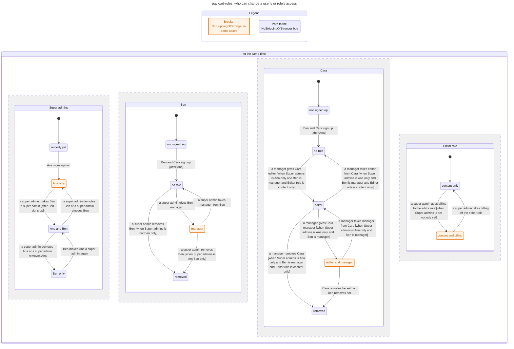

# Roles escalation guards

payload-roles decides who can change a user's or a role's access. The first user to sign up becomes a super admin. After that, only a super admin can promote, demote, or remove a super admin, and the last one can never be demoted or removed. A manager can give or take a role only when they hold everything that role grants, which is why Ben loses most of his power over Cara once the editor role includes billing. Nobody but a super admin changes their own roles, and nobody resets the password of or removes someone stronger.

The model has three users (Ana, Ben, Cara) and three permission groups: content, people (manage users and roles), and billing, which only a super admin holds at the start. It has two roles: editor (content, and a super admin can add billing) and manager (content and people). Refused attempts change nothing, so the chart does not draw them. Each rule instead checks every attempt the code would allow in every reachable state, including attempts the chart does not draw.



## Rules

| Rule                     | In plain words                                                                                                                 | Result                    |
| ------------------------ | ------------------------------------------------------------------------------------------------------------------------------ | ------------------------- |
| `AlwaysASuperAdmin`      | Once someone has signed up, there is always at least one active super admin.                                                   | Holds                     |
| `OnlySuperAdminsPromote` | Nobody makes someone a super admin unless they are one.                                                                        | Holds                     |
| `NoOneGivesWhatTheyLack` | Nobody gives access they do not hold, by handing out a role or by widening a role someone already holds.                       | Holds                     |
| `NoOneTakesWhatTheyLack` | Nobody takes away access they do not hold, by taking a role off someone or by narrowing a role.                                | Holds                     |
| `NoSelfRoles`            | Nobody changes their own roles unless they are a super admin.                                                                  | Holds                     |
| `NoTakeoverOfStronger`   | Nobody resets the password of, or removes, a super admin or anyone who holds more than they do, unless they are a super admin. | Holds                     |
| `NoStrippingOfStronger`  | Nobody takes access away from someone who holds more than they do, unless they are a super admin.                              | Breaks: a design question |

Removing each guard from a copy of the spec broke its own rule, so no rule holds vacuously.

`NoStrippingOfStronger` is a candidate rule for the reviewer, not one the plugin claims. The README promises that an editor cannot weaken a stronger user's role. It does not promise that a manager cannot take a role away from a stronger user. The shortest path has 6 steps:

1. Ana signs up first.
2. Ben and Cara sign up.
3. A super admin gives Ben manager.
4. Ben gives Cara editor.
5. Ben gives Cara manager.
6. A super admin adds billing to the editor role.

Ben can now take manager away from Cara, although she holds billing and he does not. `decideUserWrite` in `packages/payload-roles/src/guards.ts` checks that he holds every grant of the role he removes, not everything Cara holds. A replay of this path against the plugin through the integration helpers let the removal through. The same replay refused, with `Forbidden`, Ben changing his own roles, taking editor from Cara, resetting Cara's password, taking billing off the editor role, deleting Cara, and deleting Ana, and it refused Ana demoting herself as the last super admin.

## What the model leaves out

- Concurrent requests. The README's non-atomic last-super-admin limit is not covered.
- Restoring a trashed user. Trash and delete are one "removes" step.
- Password and other account-field changes are checked as rules only, never drawn as steps.
- The "publish needs update" check, which [document-lifecycle.md](document-lifecycle.md) covers.
- Payload's collection access, reduced to "holds people".
- Malformed request bodies, missing roles, bulk writes, deleting a role, and role edits other than toggling billing on the editor role.
- Sign-up order is fixed: Ana first, then Ben and Cara together. Ana holds no roles, only Ana and Ben can be super admins, Ben can only be a manager, and one role changes per request.
- The chart hides 246 steps: a super admin's role changes and removals for Cara, Cara changing or removing Ben, a manager removing Cara while she has no role, Cara taking billing off the editor role, and Ben removing himself. It also does not draw the 28 steps that stay inside one chart state.

## Regenerate

From [`roles-guards/`](roles-guards/), with the `scripts/statechart` command of the pstack `statechart` skill:

```sh
statechart RolesGuards.tla --config RolesGuards.cfg --view view.mjs --out /tmp/roles-chart
```
